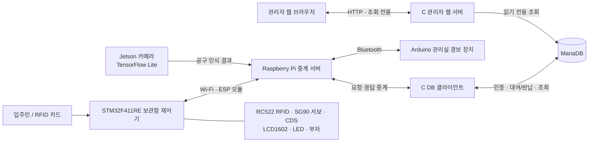

# 공구 대여 관리함

아파트 입주민이 공구를 편리하게 대여하고 반납할 수 있도록 만든 **IoT 기반 공구 대여 관리 시스템**입니다. RFID 카드로 세대를 인증하고, 카메라로 공구를 인식해 대여·반납 이력을 기록합니다. 보관함 제어기, 서버, 데이터베이스, 관리자 웹 화면을 연동했습니다.

> 현재 구현은 동작을 확인한 시제품입니다. 실제 운영 환경에 적용하기 전에는 하드웨어 내구성, 보안, 카메라 인식 성능을 추가 검증해야 합니다.

## 기술 스택


## 프로젝트 개요

가정마다 자주 쓰지 않는 공구를 구비하는 부담을 줄이고, 공동 공구의 대여 현황을 체계적으로 관리하는 것을 목표로 합니다. 사용자는 등록된 RFID 카드를 태그해 세대 인증을 받고, 보관함을 이용합니다. Jetson 카메라가 공구를 분류하면 서버와 DB 클라이언트가 인식 결과를 대여 또는 반납 기록으로 처리합니다.

## 시스템 구성



| 구성 요소 | 역할 |
| --- | --- |
| **STM32F411RE** | RFID 카드 입력, 서버 인증 요청, 서보 잠금 제어, LCD·LED 안내, 조도 기반 문 상태 추정, 경보 상태 보고 |
| **Jetson 카메라** | TensorFlow Lite 모델로 공구를 분류하고 인식 결과를 서버로 전송 |
| **Raspberry Pi 중계 서버** | 보관함, 카메라, DB 클라이언트, 관리실 장치 간 메시지 중계 |
| **C DB 클라이언트** | MariaDB 카드 인증, 공구 인식 저장, 대여·반납 상태 및 요금 처리 |
| **MariaDB** | 세대, RFID 카드, 공구, 인식 이벤트, 대여 이력 및 청구 데이터를 저장 |
| **C 관리자 웹 서버** | 브라우저에 세대·공구 현황과 대여 이력을 읽기 전용으로 제공 |
| **Arduino 관리실 장치** | 비정상 문 열림 경보를 부저와 LED로 표시 |

## 주요 기능

- **RFID 세대 인증:** 카드 UID를 서버로 보내 등록·활성 상태를 확인하고, 승인된 세대에 보관함 이용을 허용합니다.
- **보관함 제어 및 안내:** STM32가 서보 잠금장치, LCD, 상태 LED와 부저를 제어합니다.
- **공구 인식:** Jetson의 카메라와 TensorFlow Lite 모델을 이용해 스트리퍼, 드라이버, 니퍼, 롱노즈, 멀티미터기를 분류합니다.
- **대여·반납 관리:** 공구 인식 결과를 이용 세션과 연결하고, 미반납 상태에 따라 대여와 반납을 기록합니다.
- **중복 처리 방지:** 연속 프레임 확인, 인식 이벤트 ID, 이용 세션별 처리 기록으로 같은 인식 결과가 반복 처리되는 것을 줄입니다.
- **대여료·연체료 계산:** 대여 당시 정책을 기록하고 대여 기간에 따라 청구 예정 금액을 계산합니다. 기본 시험 정책은 대여료 500원, 5분 초과 연체 시 500원, 이후 5분마다 500원 추가입니다.
- **비정상 개방 경보:** 잠금 상태에서 문 열림이 감지되면 Raspberry Pi를 거쳐 관리실 Arduino에 경보를 전달합니다.
- **관리자 현황 조회:** 세대별 미반납 수와 청구 예정 금액, 공구 상태, 대여·반납 이력을 웹에서 조회합니다.

## 시스템 동작 흐름

1. 사용자가 RFID 카드를 태그하면 STM32가 카드 UID와 요청 정보를 중계 서버에 전달합니다.
2. C DB 클라이언트가 MariaDB에서 카드 및 세대 정보를 확인하고 승인 결과를 돌려줍니다.
3. 승인된 경우 보관함 잠금장치가 해제되고, 이용 세션이 시작됩니다.
4. Jetson 카메라가 세션 중 공구를 인식해 라벨, 신뢰도, 이벤트 ID를 전송합니다.
5. DB 클라이언트가 기존 대여 상태와 이용 세션을 확인한 뒤 인식 이력과 대여·반납 결과를 저장합니다.
6. 관리자는 웹 화면에서 최신 세대별·공구별 상태와 이력을 확인할 수 있습니다.
7. 잠금 상태에서 비정상적인 문 열림이 감지되면 관리실 경보 장치에 알립니다.

## 데이터와 요금 정책

- 세대 주소는 동·호수를 사용하며, 같은 호수가 다른 동에 있을 수 있어 내부 세대 ID로 구분합니다.
- 대여 이력은 세대와 공구를 참조하며, 반납 전인 동일 공구에 활성 대여가 중복되지 않도록 관리합니다.
- 기본 시험 정책은 **5분 대여료 500원**, **대여 5분 초과 시 연체료 500원**, 이후 **5분마다 500원 추가**입니다. 요금과 시간은 DB 정책 설정으로 관리합니다.
- 반납 후 미반납 개수는 줄지만, 이미 발생한 대여료와 연체료는 청구 예정 금액에 남습니다.
- 월별 청구 이력은 납부 완료 여부를 의미하지 않습니다. 실제 납부 확인 및 자동 청구는 별도 기능입니다.

## 공구 인식 평가

제공된 평가 자료 **161프레임**에서 전체 정답률은 **82.61% (133/161)**였습니다. 니퍼와 롱노즈의 혼동이 주로 관찰되었습니다. 프레임 단위의 제한된 평가 결과이며, 다양한 환경의 실제 사용 성능을 보장하는 수치는 아닙니다. 평가 자료에 실제 공구가 없는 배경(NULL) 표본이 없어 미검출 성능은 평가하지 못했습니다.

## 저장소 구성

```text
Core/                  STM32 펌웨어와 주변 장치 제어
  Inc/                 모듈 헤더
  Src/                 RFID, Wi-Fi, LCD, 서보, 문 상태, 경보, 부저
tools/                 C 중계/DB/관리자 서버, SQL 스키마 및 테스트
camera/                Jetson 카메라 클라이언트, 모델 및 라벨
admin/                 관리자 웹 화면
docs/                  장치 연결, DB 설정, 실행 및 시험 안내
```

## 실행 및 연결 안내

하드웨어 핀 연결, Pi 서버 설정, DB 마이그레이션, 카메라 준비와 관리자 화면 실행은 아래 문서를 참고하세요.

- [전체 펌웨어 핀맵](docs/parts-rental-pin-map.md)
- [Wi-Fi 및 중계 서버 연결](docs/wifi-bringup.md)
- [RFID 카드 연결](docs/rfid-bringup.md)
- [MariaDB 인증 및 자동 저장](docs/db-auth.md)
- [대여 DB·요금 정책·시험 방법](docs/rental-db.md)
- [Jetson 카메라 연결 및 실행](docs/camera-bringup.md)
- [관리자 웹 화면 설치 및 실행](docs/admin-dashboard.md)
- [서보 잠금장치 시험](docs/servo-bringup.md)
- [CDS 문 상태 측정](docs/cds-bringup.md)
- [관리실 경보 장치](docs/management-alarm.md)
- [LCD1602 및 상태 표시](docs/lcd-bringup.md)
- [보관함 부저](docs/tool-buzzer.md)

STM32 펌웨어는 STM32CubeIDE/CMake 프로젝트로 구성되어 있습니다. 로컬 빌드 산출물과 시험 파일은 저장소의 `build/` 및 `tools/`에서 확인할 수 있습니다. 장치별 실제 연결 전에 각 안내 문서의 전압, 핀 배치, 네트워크 주소와 DB 환경 설정을 확인하세요.

## 한계 및 향후 개선

- CDS 조도 센서로 문 상태를 추정하므로 외부 조명 변화가 판정에 영향을 줄 수 있습니다. 문 접점 센서 적용이 필요합니다.
- 평가 표본과 조명·배경 조건이 제한적입니다. 공구별 학습·검증 데이터와 NULL 표본을 늘려야 합니다.
- 현재 카메라 인식은 종류별 분류에 기반합니다. 같은 종류의 실물 공구가 여러 개일 때 개별 물품을 구분하는 식별 체계가 필요합니다.
- 이용 세션과 일부 상태는 MCU·서버 메모리에 유지됩니다. 재부팅 및 네트워크 단절 이후 상태 복원과 재연결을 추가 검증해야 합니다.
- 관리자 페이지는 같은 네트워크에서 사용하는 조회용 시제품이며 로그인·권한 관리 기능이 없습니다.
- 실제 운영에 앞서 장치 인증, 통신 보안, 관리자 권한, 장애 복구, 납부 확인과 자동 관리비 청구를 보강해야 합니다.

## 팀 구성

| 팀원 | 담당 |
| --- | --- |
| 이진우 | AI 공구 인식 및 서버 통신 |
| 이가영 | STM32·Arduino 센서 제어 및 핀 매핑 |
| 공동 | 하드웨어 모형 제작 및 시스템 통합 |

---

이 프로젝트는 공구 대여·반납 과정을 임베디드 제어, 영상 인식, 네트워크 통신, 데이터베이스 및 웹 조회로 연결한 시제품입니다.
